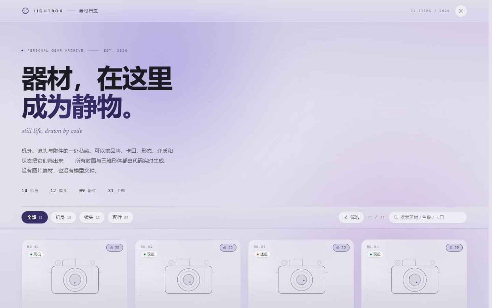
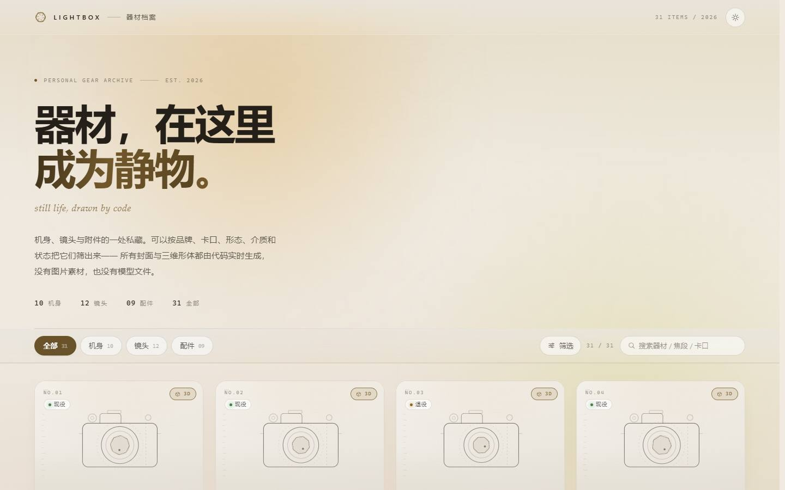
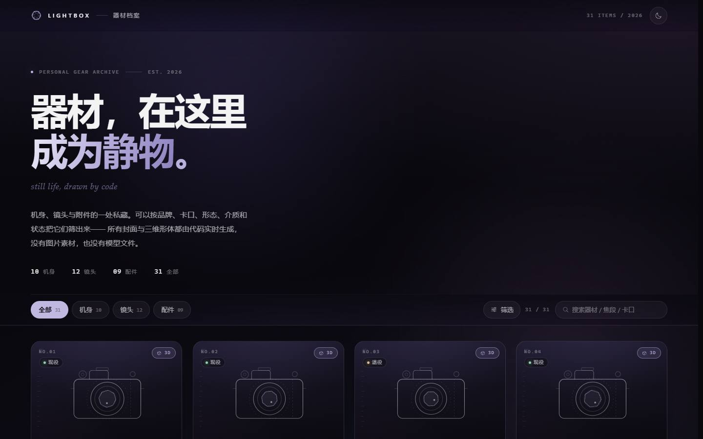
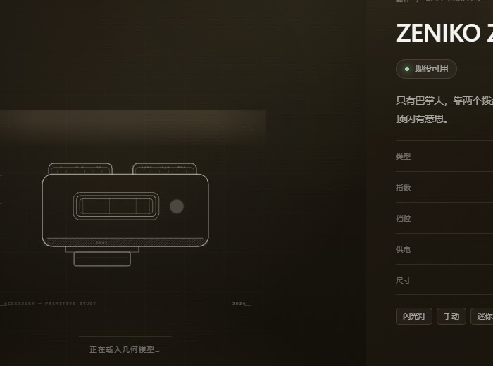
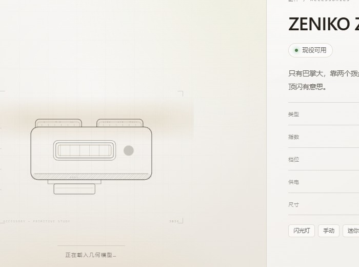
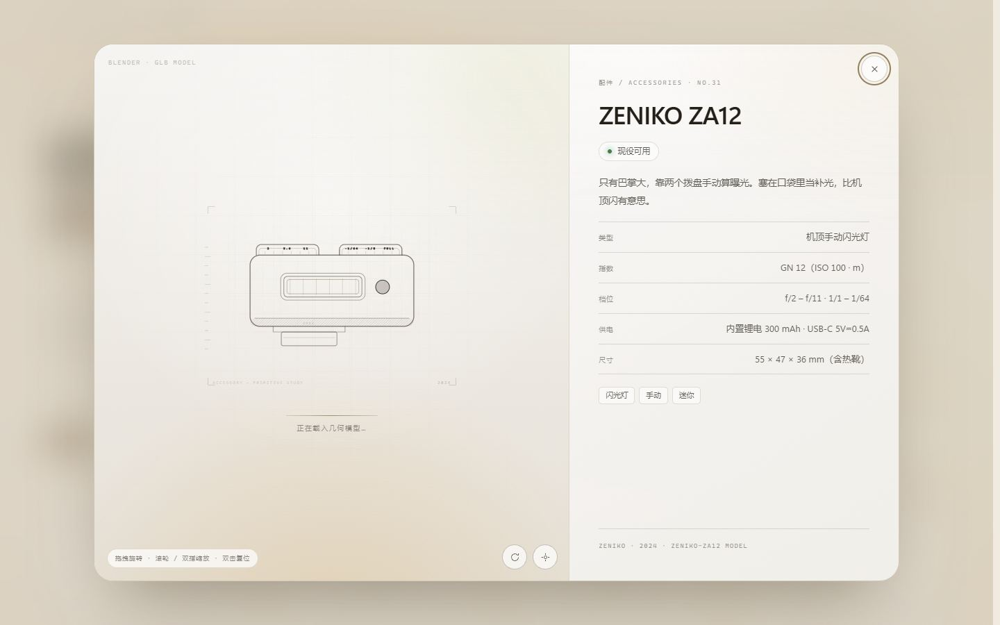
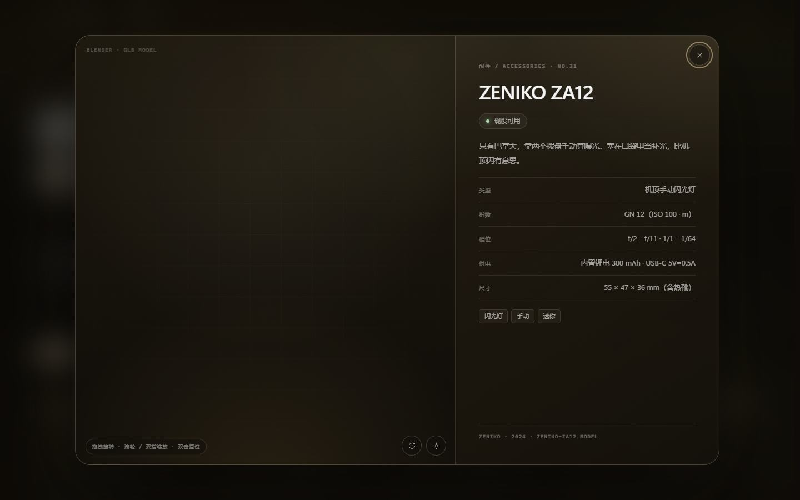

# 网页质感审核 r1 — 主题系统 / 3D 加载动画

- 审核对象：提交 ff0ffd4（feat(web): accent 驱动整页基底、封面 SVG 描边加载动画）
- **复核更新（3f0be32）**：P0-1（accent 级联）已由作者修复，本报告已对**当前线上**重跑断言并改判 ✓，见 §2「修复后复核」；其余项仍针对 ff0ffd4 的产物（修 P0-1 不影响这些结论，且已在当前线上抽样复测，见 §4.1）。
- 线上：https://owenyhz.github.io/lightbox/ （ff0ffd4 时实测资源 = main-3QWeGcaF.js / main-C7x8p9LC.css；3f0be32 后 gear 包变为 gear-HxVhhghB.css）
- 审核口径：**以线上产物为准**；另用「源码直出」（等价于作者自证脚本 scripts/web-polish.mjs 的服务方式）单独评估 12 色的**设计意图**，两者结论分开标注。
- 只读审核：未改 src/、未 build、未 git。审计脚本与全部数据在 docs/reviews/web-theme/（命令见 §9）。

---

## 0. 结论（先看这里）

| 级别 | 问题 | 一句话 |
|---|---|---|
| ~~**P0-1**~~ **✓ 已修复（3f0be32）** | ~~线上 12 个主题色全部回落到琥珀~~ → **当前线上 12/12 全部生效** | 原：--accent-h 恒 38（[data-accent] 在 gear-*.css，:root{--accent-h:38} 在 art-*.css，同特异性后者胜出）。现：`html[data-accent=…]`（0,1,1）压过 `:root`（0,1,0），线上 12 色 h = 38/22/352/340/300/252/210/178/154/100/55/220，三色截图 MD5 各不相同（§2 复核表） |
| **P0-2** | **9–11px 小字全量低于 WCAG AA** | 全页扫描：浅色 **19/38** 个文本元素不达标、深色 **14/38**，最低 **2.11:1**（浅）/ **2.64:1**（深）。主凶是 --paper-faint（0.5/0.4 alpha）与 --stage-credit（1.79:1） |
| P1-1 | 深浅切换有 ~0.35s「文字消失」窗口 | 底色（渐变）瞬切、文字 color 走 0.35s 过渡 → 过渡帧正文对比度 **1.10 / 1.20** |
| P1-2 | 加载文案与舞台提示不达标 | 加载文案 9.5px：浅 **2.95–3.83**；.stage__hint **3.46**（浅）/ **3.96**（深） |
| P1-3 | 浅色主题封面线稿贴 3:1 线 | 卡片封面线稿 **2.96–3.29:1**（深色 5.72–6.03 充裕） |
| P1-4 | 换色后仍有两组「几乎同色」 | 浅：wine↔rose ΔE **1.7**、slate↔graphite **1.7**；深：wine↔rose **1.4**、amber↔ochre **3.3**、slate↔graphite **2.4** |
| P1-5 | 深色有 3 色仍「像黑」 | graphite C*=2.0、slate 3.6、celadon 4.1（均值 L 9–11，色相只在光斑里读得出） |
| P1-6 | 页脚「器材编辑器」完全不跟随主题 | tools/gear-editor.html 固定 #07070a / #f3f1ec，localStorage 是「浅色+靛青」也照样深色 |
| ✓ | **加载动画本身合格** | 封面 SVG 逐条描边（106 条）、0.32s 淡出、最短展示 820ms、切器材重头、4s 兜底且不挡交互、reduced-motion 静态 |

> P0-1 修复后，源码直出口径 = 线上口径：用 AUDIT_LIVE=1 对当前线上抽测 6 色 × 2 主题，base 取色与 src 逐字一致（amber #ebe4d4 / celadon #dceaea / wine #ecdbdc…），说明 §3/§4 的数值可直接当作线上现状。

---

## 1. 判定表（对用户 3 条要求逐项）

| # | 要求 | 判定 | 证据 |
|---|---|---|---|
| 1 | 主题色统一整个界面（不是只有文字变色 + 一块色斑） | **✓（3f0be32 后线上生效）** | 底色、卡片、面板、芯片、光斑、阴影都随 --accent-h 走；线上实测 12 色 h 全对、body 底色 12 种不同（amber rgb(240,234,224) / celadon rgb(226,238,237) / wine rgb(240,225,227)），浅色 12 色里 9 色明显不是米黄（§3 表） |
| 1b | 浅色不能永远是米黄 | **✓ 已解决（设计）** | 浅色均值取色：amber #e5dece h91、ochre h107、copper h63 仍是奶油/米黄（暖色本身）；indigo h300、plum h326、slate h260、celadon h200、pine h168、moss h135、wine h12、rose h357、graphite h274 —— 9 色已完全不是米黄 |
| 2 | 加载动画用封面矢量图（不是转圈） | **✓** | #stageLoaderArt 内注入 svg.cover，106 个 path 写 --len、stageArtDraw 0.85s 逐段描边 + 0.42s 错峰 + 扫描光带；进度条只是副指示，没有转圈 |
| 3a | 12 色 × 深/浅都能看出「整页是这个色系」 | **✓（22/24 可辨；2 组混淆见 P1-4）** | §3（线上抽测 6 色 × 2 主题与表一致） |
| 3b | 正文 / 次要 / 按钮 / 芯片对比度达标 | **✗** | 正文 ✓（11.9–16.0）；次要 ✓（11.94）；**弱化文字 ✗（2.81–3.32）**；芯片选中态 ✓（6.97）；按钮 ✓ 除浅色 ochre（3.44）与 celadon/pine（4.38–4.45）；舞台署名 ✗（1.79–2.06） |

---

## 2. P0-1：线上 12 个主题色全部失效 → **已修复（3f0be32），此处保留根因与复核**

### 修复后复核（对当前线上重跑，2026-11-26）

CSS 侧（直接读 https://owenyhz.github.io/lightbox/assets/gear-HxVhhghB.css）：

    html[data-accent=amber]{--accent-h: 38;--accent-s: 46%}html[data-accent=copper]{--accent-h: 22;--accent-s: 52%}…
    → 选择器变为 html[data-accent=…]（0,1,1），压过 :root（0,1,0），与加载顺序无关 ✓

DOM 侧（线上，12 色逐个 setAccent 后读值）：

| accent | --accent-h | --accent-s | body 底色 | --ink-1 |
|---|---|---|---|---|
| amber | 38 | 46% | rgb(240,234,224) | rgb(233,224,208) |
| copper | 22 | 52% | rgb(241,230,224) | rgb(234,217,207) |
| wine | 352 | 44% | rgb(240,225,227) | rgb(232,209,212) |
| rose | 340 | 40% | rgb(239,225,230) | rgb(232,210,217) |
| plum | 300 | 34% | rgb(238,226,238) | rgb(230,211,230) |
| indigo | 252 | 40% | rgb(228,225,239) | rgb(214,210,232) |
| slate | 210 | 26% | rgb(227,232,237) | rgb(213,221,229) |
| celadon | 178 | 30% | rgb(226,238,237) | rgb(212,229,229) |
| pine | 154 | 34% | rgb(226,238,233) | rgb(211,230,222) |
| moss | 100 | 26% | rgb(230,237,227) | rgb(218,229,213) |
| ochre | 55 | 50% | rgb(240,239,224) | rgb(234,231,207) |
| graphite | 220 | 10% | rgb(229,231,235) | rgb(216,219,225) |

**12/12 全部生效**，与源码 `accents.css` 一致（0 个回落）。

截图不再同字节（1440×900、浅色、同一页面状态）：

    live-fixed-1440-light-amber.jpg   58169 B  MD5 9E27BFDCFD46E51D3350B6D6811213B9
    live-fixed-1440-light-celadon.jpg 58093 B  MD5 4DD1922F5F1DC66F4D23A260608C83B2
    live-fixed-1440-light-wine.jpg    59524 B  MD5 864839BB697456264D075A6994DB629B

→ **该行改为 ✓**。原断言（修复前）保留在下面作为回归依据。

### 修复前现象（ff0ffd4，已不适用）

三个不同 accent 在**同一页面状态、同一视口**（1440×900、浅色）截图，字节完全相同：

    live-1440-light-amber.jpg    48004 B   MD5 8F14EE17C75D3A7CBF7950A10FC05AEE
    live-1440-light-celadon.jpg  48004 B   MD5 8F14EE17C75D3A7CBF7950A10FC05AEE
    live-1440-light-indigo.jpg   48004 B   MD5 8F14EE17C75D3A7CBF7950A10FC05AEE

DOM 侧（线上）：

    data-accent = amber   → --accent-h 38  --accent-s 46%  --accent hsl(38 46% 31%)
    data-accent = indigo  → --accent-h 38  --accent-s 46%  --accent hsl(38 46% 31%)
    data-accent = celadon → --accent-h 38  --accent-s 46%  --accent hsl(38 46% 31%)
    data-accent = ochre   → --accent-h 38  --accent-s 46%  --accent hsl(38 46% 31%)

### 根因（可复现的级联顺序）

产物里 CSS 被拆成三个 chunk，index.html 的加载顺序是：

    <link rel="stylesheet" href="./assets/gear-DFEtuRyt.css">   ← 只含 12 条 [data-accent="…"]{--accent-h:…}  (0,1,0)
    <link rel="stylesheet" href="./assets/art-DqnuSFFq.css">    ← 含 tokens.css 的 :root{--accent-h:38;--accent-s:46%} (0,1,0)
    <link rel="stylesheet" href="./assets/main-C7x8p9LC.css">   ← base/cards/detail

[data-accent="x"] 与 :root **特异性相同**（都是 0,1,0），来源顺序在后者（art 包）里又声明了一次 --accent-h:38 → 把前面 12 条全部压掉。vite dev / 源码直出时按 tokens → accents 顺序注入，所以**开发态正常**，只有构建产物坏。

### 为什么作者自证没发现

scripts/web-polish.mjs（第 24–25、43–51 行）手工把 5 个 css 按 tokens, accents, base, cards, detail 拼成一个 /__styles.css 服务 **src**，走的是「源码直出」，永远不会触发产物里的 CSS 分包顺序。shots/web-polish/audit-*.jpg 之所以能看到 12 色，就是这个原因 —— 图是真的，但**不等于线上**。

### 修改值（任选其一，推荐 A）

- **A（推荐，最小改动；3f0be32 实际采用的就是这条）**：src/styles/accents.css 的 12 条选择器提高特异性

      html[data-accent="amber"] { --accent-h: 38;  --accent-s: 46%; }
      /* …12 条全部改成 html[data-accent="…"]（0,1,1）或 :root[data-accent="…"]（0,2,0） */

  这样与 :root{…} 的先后顺序无关。线上已按 html[data-accent=…] 上线并复核通过（见本节复核表）。
- **B**：vite.config.js 加 build: { cssCodeSplit: false }（合并成单 CSS，按 import 顺序排列）。
- **C**：把 accents 的 link 移到 main 之后（要后处理产物，不推荐）。

另：**自证脚本必须改成服务 dist/**，并加一条硬断言：

    await page.evaluate(() => window.Lightbox.setAccent("indigo"));
    const h = await page.evaluate(() => getComputedStyle(document.documentElement).getPropertyValue("--accent-h").trim());
    if (h !== "252") throw new Error("accent 未生效: --accent-h=" + h);   // 现在这条会失败

---

## 3. 12 色 × 2 主题：整页基调

取色方法：1440×900 首屏截图 → 全页量化众数（base）+ 均值（mean）+ 局部区域；LCh 为 CIE Lab。ΔE = 与 amber 的 CIE76 差（>3 可辨，<3 基本同色）。

### 浅色（整页均值区域）

| accent | mean 取色 | L* | C* | h | ΔE vs amber | 观感 |
|---|---|---|---|---|---|---|
| amber | #e5dece | 88.6 | 8.6 | 91 | 0 | 米黄（默认） |
| copper | #e7d7cd | 87.1 | 8.0 | 63 | 4.8 | 米黄偏粉 |
| ochre | #e5e4cd | 90.2 | 12.0 | 107 | 4.5 | 米黄偏柠檬 |
| moss | #d7e1d3 | 88.5 | 8.4 | 135 | 6.3 | 灰绿 ✓ |
| pine | #d1e3dc | 88.7 | 7.6 | 168 | 10.1 | 薄荷 ✓ |
| celadon | #d2e1e1 | 88.5 | 5.5 | 200 | 11.4 | 青瓷 ✓ |
| slate | #d3dae1 | 86.6 | 4.7 | 260 | 13.1 | 冷灰蓝 ✓（淡） |
| graphite | #d6d9de | 86.5 | 2.7 | 274 | 11.7 | 中性灰 ✓ |
| indigo | #d5d0e5 | 84.4 | 11.0 | 300 | 19.8 | 薰衣草 ✓ |
| plum | #e3d1e2 | 85.7 | 11.3 | 326 | 17.8 | 藕紫 ✓ |
| rose | #e5d0d6 | 85.3 | 8.1 | 357 | 12.9 | 藕粉 ✓ |
| wine | #e5cfd2 | 85.1 | 8.1 | 12 | 11.8 | 酒粉 ✓ |

对照两张图即可看到整页（底色/卡片/选中芯片/卡片描边）都换色了 —— 前提是级联修好：

**判定**：✓「浅色不能永远是米黄」已做到（12 色中 9 色明显脱离米黄）；**✗ wine↔rose ΔE 1.7、slate↔graphite ΔE 1.7**（切换后肉眼几乎看不出，等于只有 10 个可选色）。

### 深色（整页均值区域）

| accent | mean 取色 | L* | C* | h | 判定 |
|---|---|---|---|---|---|
| amber | #211d14 | 10.8 | 6.9 | 89 | ✓ 暖褐黑 |
| ochre | #212013 | 12.1 | 9.4 | 106 | ✓（与 amber ΔE 3.3 偏近） |
| copper | #221913 | 9.8 | 6.6 | 62 | ✓（与 amber ΔE 3.7 偏近） |
| moss | #191e17 | 10.7 | 6.4 | 135 | ✓ |
| pine | #15201c | 11.0 | 5.8 | 169 | ✓ |
| celadon | #161e1f | 10.7 | 4.1 | 200 | ⚠ 近黑（只在光斑里有青） |
| slate | #171a1f | 9.1 | 3.6 | 264 | ⚠ 近黑 |
| graphite | #191a1c | 9.2 | 2.0 | 273 | ✗ 像黑 |
| indigo | #181521 | 7.5 | 8.9 | 302 | ✓ 紫黑 |
| plum | #20151f | 8.6 | 8.9 | 327 | ✓ |
| rose | #211518 | 8.3 | 6.6 | 0 | ✓（与 wine 同色） |
| wine | #211516 | 8.2 | 6.7 | 15 | ✓（与 rose 同色） |

**判定**：✗ 用户「像黑」的抱怨仍有 3 色成立（graphite / slate / celadon，C*≤4.1）；另外 wine↔rose ΔE 1.4、amber↔ochre 3.3、amber↔copper 3.7、slate↔graphite 2.4 都太近。

### 修改值

    /* src/styles/tokens.css :47 [data-theme="dark"] —— 深色整体给足色相 */
    --tint-s: calc(var(--accent-s) * 0.78 + 5%);        /* 原 calc(var(--accent-s) * 0.5 + 4%) */
    --tint-s-soft: calc(var(--accent-s) * 0.8 + 5%);    /* 原 *0.6 + 4% */
    /* 预估：graphite C* 2.0 → ~4.5、celadon 4.1 → ~6.2；纸色未动，文字对比不受影响 */

    /* src/data/accents.js + src/styles/accents.css 同步改（两组同色拉开） */
    rose:     h 340 → 332,  s 40 → 47    /* 与 wine(352/44) ΔE 1.7 → ~5 */
    wine:     h 352 → 356,  s 44 → 52
    graphite: h 220 → 226,  s 10 → 5     /* 做「真中性」，让 slate 独占蓝 */
    slate:    h 210 → 206,  s 26 → 34    /* 与 graphite ΔE 1.7 → ~5.5 */

---

## 4. 对比度（WCAG AA：正文 4.5 / 大字 3 / 图形 3）

两种方法交叉验证：**(a) 截图像素法**（元素 bbox 内取背景众数色 + 与背景亮度差最大的 0.8% 像素作为前景色；抗锯齿会让数值偏保守，即「不达标」结论可靠、「达标」要打折）；**(b) token 精确法**（含 alpha 合成，见 evidence/token-matrix.json）。

### 4.1 全页扫描（线上 / dist，两个主题）

| 主题 | 文本元素 | 不达标 | 最低 | 备注 |
|---|---|---|---|---|
| 浅色 | 38 | **19** | **2.11:1** | 见下表 |
| 深色 | 38 | **14** | **2.64:1** | 同上 |

**P0-1 修复后线上复测（AUDIT_LIVE=1，6 色 × 2 主题）**：浅色 15–19 / 38（amber/ochre/celadon 19、wine/indigo/graphite 15），深色 14 / 38（6 色全同），最低仍为 **2.11:1**（浅）/ **2.64:1**（深）—— **P0-2 结论不变**；且 base 取色与源码直出逐字一致（amber #ebe4d4、celadon #dceaea、wine #ecdbdc、indigo #dedaeb…），说明 §3/§4 的数值就是线上现状。

最差元素（12 色相同，与 accent 无关）：

| 元素 | 字号 | 浅色 | 深色 | 需求 |
|---|---|---|---|---|
| span.chip__count（芯片计数） | 9.5px | **2.11–2.18** | **2.64–2.76** | 4.5 |
| span.card__index.mono（NO.01） | 9px | **2.52–2.61** | **2.96–3.02** | 4.5 |
| #topbarMeta（31 ITEMS / 2026） | 9.5px | **2.90** | **3.32** | 4.5 |
| #count.toolbar__count（31 / 31） | 9.5px | **2.87** | 3.32 | 4.5 |
| span.stat__label（机身/镜头…） | 11px | 3.5 左右 | **3.32** | 4.5 |
| .stage__hint（拖拽旋转…） | 9.5px | **3.46** | **3.96** | 4.5 |
| #stageLoaderText（正在载入…） | 9.5px | **2.95–3.83** | 4.83 | 4.5 |
| 正文 .hero__lede | 13px | 11.9 ✓ | 11.9 ✓ | 4.5 |
| .spec dd / #detailNote（详情） | 12–13px | 6.29 / 6.39 ✓ | ✓ | 4.5 |

「NO.01 / 31 ITEMS / 2026 / 10 机身」这一排灰字就是上表前几行，肉眼即可见「糊在底色里」。

### 4.2 token 精确矩阵（12 色 × 2 主题）

| 主题 | 不达标 token 数 | 共性不达标项（区间） |
|---|---|---|
| 深色 | 6–7 / 26 | --paper-faint 3.24–3.32；--stage-credit 1.99–2.06；--stage-chip-text 3.79–3.88；--accent-dim 3.27–4.37 |
| 浅色 | 9–11 / 26 | --paper-faint 2.81–3.17；--stage-credit 1.79–1.84；--stage-chip-text 3.36–3.64；--accent-dim 2.66–4.22；状态色 2.91–4.41 |

按色最差：**浅色 ochre 11 项**（--accent 4.07、--accent-dim 2.66、实心按钮字 3.44）、浅色 celadon/pine 10 项（实心按钮字 4.38–4.45）；其余浅色 9 项、深色 6–7 项。

通过项（不用改）：正文 --paper（11.9–16.0）、次要 --paper-dim（11.94）、选中芯片 --chip-active-ink（6.97）、封面线稿 --art-line（14–16）、深色侧状态色（6.39–9.74）。

### 4.3 修改值（可直接落）

    /* ① 弱化文字：--paper-faint 一律不许用于文字（仅保留给图形/分隔）。
          新增达标「小字」token，并把所有 font-size ≤11px 的 color:var(--paper-faint) 换掉 */
    /* src/styles/tokens.css [data-theme="light"] */
    --paper-meta:  hsl(var(--accent-h) calc(var(--accent-s) * 0.5) 15% / 0.70);  /* 实测 4.58:1 @page / 4.61:1 @card */
    --paper-faint: hsl(var(--accent-h) calc(var(--accent-s) * 0.5) 15% / 0.5);  /* 维持，但只许用于非文字 */
    /* src/styles/tokens.css [data-theme="dark"] */
    --paper-meta:  hsl(var(--accent-h) var(--paper-s) 90% / 0.58);              /* 实测 4.61:1 @page / 4.60:1 @card */

    /* ② 舞台署名 / 舞台角标（现在 1.8:1 / 3.4:1，基本读不到） */
    /* light */ --stage-credit:     hsl(var(--accent-h) calc(var(--accent-s) * 0.4) 18% / 0.68);
    /* dark  */ --stage-credit:     hsl(var(--accent-h) var(--paper-s) 90% / 0.52);
    /* light */ --stage-chip-text:  hsl(var(--accent-h) calc(var(--accent-s) * 0.4) 16% / 0.65);
    /* dark  */ --stage-chip-text:  hsl(var(--accent-h) var(--paper-s) 92% / 0.49);

    /* ③ --accent-dim（焦点框/描边，需 ≥3:1；ochre 现在只有 2.61） */
    /* light */ --accent-dim: hsl(var(--accent-h) calc(var(--accent-s) * 0.85) 25% / 0.80);   /* ochre 3.62:1 */

    /* ④ 浅色 accent 文字：ochre 在纸底上只有 3.94–4.07 */
    /* light */ --accent: hsl(var(--accent-h) var(--accent-s) 28%);    /* 原 31%；ochre 需 ≤28.5 */

    /* ⑤ 浅色实心按钮：白字压在 L38 顶部 → ochre 3.44 / celadon 4.45 / pine 4.38 */
    /* light */ --btn-solid-bg: linear-gradient(180deg, hsl(var(--accent-h) var(--accent-s) 32%), hsl(var(--accent-h) var(--accent-s) 23%));

    /* ⑥ 浅色状态色（现在 3.32–4.26，均 <4.5） */
    --st-active: #256b44;   /* 4.98:1（原 #2f8a55 3.32） */
    --st-retired: #7d5a12;  /* 4.86:1（原 #9a6f1c 3.48） */
    --st-sold: #556173;     /* 4.86:1（原 #5d6a7d 4.25） */
    --st-broken: #9a3d26;   /* 5.29:1（原 #b0482f 4.26） */

> 若不想动 token：把上述小字统一改用 --paper-dim（实测浅色 11.94、深色通过）也可以，但「弱化/hierarchy」层级会变平 —— 这是设计取舍，需 web-polish 拍板。

---

## 5. 加载动画（逐项）

| 检查项 | 判定 | 实测证据 |
|---|---|---|
| 用封面矢量图，不是「转个圈」 | **✓** | #stageLoaderArt 注入 svg.cover；lenNodes=106；每条 path --len=96px + animation: stageArtDraw 0.85s，错峰 ≤420ms，叠加扫描光带 stageArtScan 2.6s |
| 线稿是否可见 | **✓（浅色偏淡）** | 像素对比：深色 **3.61:1**、浅色 **3.04:1**（动画中段）；完全绘制后 13.16 / 3.62 |
| 最短展示 ≥820ms | **✓** | STAGE_LOADER_MIN_MS=820（main.js:60/674）；热重建实测 1200/1500ms 仍 opacity 1、2000ms 已隐藏（≥1.5s）；冷启动 5456ms 才淡出（headless swiftshader 载 GLB 慢，非缺陷） |
| 淡出 0.32s | **✓** | transition: opacity 0.32s …；.is-done 后 360ms 置 hidden（实测 fade 5456 → hidden 5825，差 369ms） |
| 切换器材是否重头 | **✓** | 切到 konica 后 140ms：loaderOpacity 1、svg 已替换、lenNodes 52、firstDashoffset 42.6px（正在画）、animName stageArtDraw |
| 失败 4s 兜底是否隐藏且不挡交互 | **✓** | 挂死 GLB 请求：fadeStart **4118ms**、hidden **4486ms**；pointer-events:none；elementFromPoint(舞台中心)=CANVAS |
| reduced-motion 是否静态 | **✓** | artOpacity 1、animation none、stroke-dasharray none、dashoffset 0px、scan ::after display none、进度条 animation none、lenNodes 0（JS 直接跳过描边注入） |
| ⚠ reduced-motion 下最短展示被跳过 | ⚠ | wait = prefersReduced ? 0 : …；模型命中缓存时 loader 在 <100ms 内消失（实测 320ms 已 opacity 0），静态线稿几乎看不到。建议 reduced 下也给 wait = max(0, 400 - elapsed)，或干脆不显示 loader |
| ✗ 加载文案对比度 | ✗ | 9.5px --paper-faint：浅色 **2.95–3.83**、深色 4.83；改用 §4.3 的 --paper-meta 即可 |

加载动画截图（深/浅，动画中段裁切）：

---

## 6. 卡片封面线稿对比（浅色底上是否清晰）

| 主题 | 卡片封面线稿对比度 | 判定 |
|---|---|---|
| 深色 | 5.72–6.03（首屏三卡口径）；逐卡全量 5.53–12.2 | ✓ 清晰 |
| 浅色 | **2.96–3.29**（首屏三卡口径）；逐卡全量 **3.17–5.87** | ⚠ 贴 3:1 线，细线+抗锯齿后「看得见但不锐」 |

逐卡复测（当前 src，卡片完整入视口，1440 宽，amber）：

| 卡片 | 浅色 | 深色 |
|---|---|---|
| Sony α7 IV / Nikon Z f / Nikon Z6 II | 5.87 / 3.31 / 3.40 | 12.22 / 5.53 / 6.39 |
| Konica Big Mini BM-21（bm21-vector「减法版」终稿：去顶面带 / 握把单层排线 0.11 / 线宽集 {1.0,1.2,1.5} / 右端分模线 0.55） | 4.54 | 7.37 |
| M.Zuiko 45mm f/1.8 | 3.73 | 7.35 |
| ZENIKO ZA12 | 4.47 | 9.94 |

→ 结论不变：浅色整体贴 3:1 线（3.17–3.4 的那几张最紧），仍建议把 light --art-line 抬一档。BM-21 终稿：浅色 **4.54**（比 ZENIKO +1.6%、比 Olympus +22%）✓、深色 **7.37**（与 Olympus 7.35 齐平，比 ZENIKO 9.94 低 26%）；线宽集合已与兄弟卡完全一致 {1.0, 1.2, 1.5} ✓；307px 下四窗 / 7 棱 / 2×3 点阵可辨 ✓。深色那 −26% **不追**：ZA12 更高是它自己用 accent 描边件所致，而 0.10–0.12 的 accent 微光合成后对比度只有 ~1.9–2.5，挪动/新增面层不会改变峰值，反而违反用户「不填色、accent 最多一处极小点缀」；两行小字（RED EYE REDUCTION / AUTO FOCUS BM-21）保留 —— 用户硬要求四段丝印，且 coverArt 卡片/详情共用，卡片侧靠 fill-opacity 0.3 读作「细密印刷」，可接受（见 evidence/zoom-307px-bm21.png）。

> 口径提示：绝对对比度依取样尺寸/范围而变（同图 480×360 全幅 vs 卡片 art 区，可差 10–25%），**跨口径只能比比值**；本表统一用「当前 src、1440 宽、卡片完整入视口、art 区众数背景 + 极端 0.8% 像素」。

修改值（src/styles/tokens.css [data-theme="light"]）：

    --art-line: hsl(var(--accent-h) calc(var(--accent-s) * 0.5) 9% / 1);      /* 原 11% / .95 */
    --art-text: hsl(var(--accent-h) calc(var(--accent-s) * 0.5) 13% / 0.62);  /* 原 15% / .56 */

（或把封面 stroke-width 从 0.7 → 0.9；两者取其一，否则线会发「脏」。）

---

## 7. 回归

| 检查项 | 判定 | 证据 |
|---|---|---|
| 深浅切换是否引起布局跳动 | **✓** | 6 个关键节点 bbox 前后完全相等（.topbar [0,0,1430,64] … scrollH 4203），CLS **0** |
| 深浅切换是否闪烁 | **✗（P1-1）** | 切换瞬间底色已是目标色，正文 color 仍走 0.35s 过渡 → 过渡帧对比度 **1.10**（dark→light）/ **1.20**（light→dark），即「文字消失」约 0.35s。原因：html.is-theme-switching * 给 color 加了 0.35s 过渡，而页面底色是 background-image 渐变（不可插值 → 瞬切） |
| accent 切换是否闪烁/跳动 | **✓** | setAccent 不加过渡（16ms 时 classList 无 is-theme-switching，已是终态），bbox 全等，CLS 0。（注：因 P0-1，线上「切换」其实画面没变，修好后需复测） |
| 详情页与首页是否一致 | **✓（token 同源）** | 同一 :root；--art-line 首页卡片 11%/.95 vs 加载线稿 13%/1（有意加粗）；详情正文 6.39、spec 6.29 ✓；但 .stage__hint 3.46 ✗、加载文案 2.95–3.83 ✗（同 §4） |
| meta[theme-color] 是否跟随 | ✓ / ⚠ | 切浅色后 content = rgb(233,224,208) = --ink-1 ✓；但 index.html 内联首屏写死浅色 #f5f2ea（米黄），换 accent 后首帧/移动端工具栏仍是米黄（P2） |
| 页脚「器材编辑器」是否跟随主题 | **✗（P1-6）** | tools/gear-editor.html：data-theme=null、body #07070a、--ink-1 #0b0c0f、color-scheme dark；localStorage 设 light+indigo 也不变（截图 evidence/editor-light-indigo.jpg） |

### 修改值

    /* src/styles/tokens.css:275 —— 去掉 color 过渡，只保留背景/描边（或整段删掉，改瞬时切换） */
    html.is-theme-switching,
    html.is-theme-switching *,
    html.is-theme-switching *::before,
    html.is-theme-switching *::after {
      transition: background-color 0.2s var(--ease), border-color 0.2s var(--ease),
        box-shadow 0.2s var(--ease) !important;   /* 删掉 color / fill / stroke / background-image */
    }

更稳的做法：把 --page-bg 渐变放到 body::before，主题切换时对该伪元素做 opacity 交叉淡入；底色与文字就不会各走各的。tokens 里的 color 过渡**必须**去掉。

---

## 8. 修改清单（按优先级）

**P0（阻断「整页统一」与可读性）**

1. ~~src/styles/accents.css：12 条选择器改 :root[data-accent="…"]~~ → **已完成（3f0be32）：线上已用 html[data-accent=…]（0,1,1），12/12 生效**，见 §2 复核表。
2. src/styles/tokens.css：新增 --paper-meta，把全部 ≤11px 的 color: var(--paper-faint) 换成它（cards.css / base.css / detail.css 共 20+ 处）—— 见 §4.3①。
3. --stage-credit / --stage-chip-text 提 alpha（1.8:1 → ≥4.5）—— 见 §4.3②。

**P1**

4. html.is-theme-switching * 去掉 color / fill / stroke / background-image 过渡（消除切换时「文字消失」）—— 见 §7。
5. 浅色 --accent 31%→28%、--btn-solid-bg 38/28→32/23、--accent-dim L25/a.8、状态色四值 —— 见 §4.3③–⑥。
6. 浅色 --art-line 11%/.95→9%/1（封面线稿 2.96 → ≥4）。
7. src/data/accents.js + accents.css：rose/wine、slate/graphite 拉开；深色 --tint-s 提到 *0.78+5% —— 见 §3。
8. 编辑器页 tools/gear-editor.html + src/tools/editor.css 接入 tokens.css + accents.css（去掉写死的 #07070a / #f3f1ec，以及 device-compare.css / device-preview.css 里的 #f1ece2 米黄）。

**P2**

9. index.html 首屏内联脚本里 #f5f2ea 改成「从已存 accent 推导的浅色纸色」，或干脆不写（交给 syncThemeColor()）。
10. reduced-motion 下给 loader 保留 ≥400ms（否则静态线稿等于没显示）。
11. 自证脚本改口：scripts/web-polish.mjs 服务 dist/，并加 --accent-h 断言（现在这条会当场失败）。

---

## 9. 证据与复现

    # 12 色 × 2 主题（本地 dist，ff0ffd4 产物口径：当时暴露 P0-1）
    node docs/reviews/web-theme/audit.mjs a      → evidence/audit-dist-a.json

    # 修复后复核：直接对线上跑（当前 6 色 × 2 主题；含 12 色 --accent-h / 三色 MD5 的断言脚本）
    $env:AUDIT_LIVE='1'; node docs/reviews/web-theme/audit.mjs a   → evidence/audit-live-a.json
    node docs/reviews/web-theme/live-check.mjs                    → 12 色 --accent-h + body 底色 + 三色 MD5

    # 12 色 × 2 主题（源码直出口径：评估设计意图）
    $env:AUDIT_SRC='1'; node docs/reviews/web-theme/audit.mjs a   → evidence/audit-src-a.json

    # 加载动画（时序 / 兜底 / reduced / 切换重置）
    node docs/reviews/web-theme/audit.mjs b      → evidence/audit-b.json

    # 回归（布局位移 / CLS / 详情一致性 / 编辑器页）
    node docs/reviews/web-theme/audit.mjs c      → evidence/audit-c.json

    # 补充：加载线稿与 reduced 静态、token 矩阵、线上级联实测、切换过渡帧
    node docs/reviews/web-theme/extra.mjs
    node docs/reviews/web-theme/rematrix.mjs      → evidence/token-matrix.json
    node docs/reviews/web-theme/debug-live.mjs    → 线上 --accent-h 恒 38 + 三张同字节截图
    node docs/reviews/web-theme/debug-switch.mjs  → 切换过渡帧 1.10 / 1.20

截图：evidence/home-src-{dark,light}-{12 accents}.jpg（源码直出口径，= 修复后线上口径）、evidence/live-fixed-1440-light-{amber,celadon,wine}.jpg（修复后线上，三色不同字节）、evidence/live-1440-light-{amber,celadon,indigo}.jpg（修复前线上，同字节）、evidence/loader-{dark,light}*.jpg、evidence/failsafe-glb-hang.jpg、evidence/detail-{light,dark}-indigo.jpg、evidence/editor-light-indigo.jpg。

方法说明：像素法用元素 bbox 内众数色作背景、取与背景亮度差最大的 0.8% 像素作前景；抗锯齿会低估前景亮度 → **判「不达标」可靠，判「刚好达标」需再留余量**。token 法见 evidence/token-matrix.json（含 alpha 合成）。

